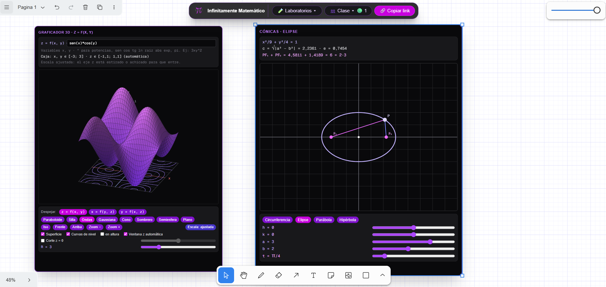
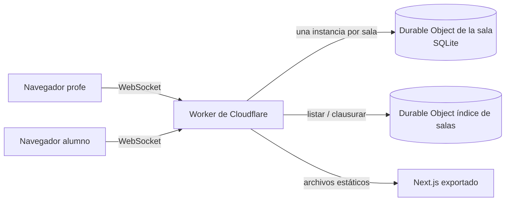

# MathBoard

Pizarra colaborativa en tiempo real para dar clases online de matemática. La profe abre una sala, comparte el link y los alumnos dibujan, escriben y manipulan herramientas matemáticas sobre el mismo lienzo, en vivo.

**[Probar la demo](https://mathboard.infinitamentemath.workers.dev/?sala=demo)**



## Qué se puede hacer

- **Lienzo infinito compartido**, con fondo de cuaderno, sobre el que todos los participantes de la sala dibujan a la vez.
- **Laboratorios interactivos** que se insertan en el lienzo y se manipulan durante la clase:

| Área | Laboratorios |
|---|---|
| Geometría | Regla, transportador, escuadra y compás |
| Álgebra y geometría | Cuadrado del binomio, matriz 2×2, círculo trigonométrico, cónicas |
| Cálculo I | Límites, estudio de la derivada, integral definida |
| Cálculo II | Coordenadas polares, superficies y derivadas parciales, integral doble, cambio de variables |
| Graficadores | Graficador libre en 2D y graficador 3D |

- **Visor de PDF** para proyectar un apunte o una guía de ejercicios y escribir encima.
- **Gestión de salas para la profe**: crear y clausurar salas, ver quién está conectado y el historial de entradas y salidas.

## Stack

- **Next.js 16** con App Router, exportado como sitio estático
- **React 19** y **TypeScript** en modo estricto
- **Tailwind CSS 4**
- **tldraw 5** como base del lienzo; cada laboratorio es una *shape* propia
- **tldraw sync** sobre **Cloudflare Workers** y **Durable Objects** con SQLite para la colaboración en vivo
- **pdf.js** para el visor de PDF, que corre solo en el navegador

## Cómo funciona



- **Una sala, un Durable Object.** Todos los que abren la misma sala se conectan a la misma instancia, que guarda el estado del lienzo en su SQLite y reparte cada cambio al resto. Como cada sala tiene un único dueño, dos personas editando a la vez no se pisan.
- **Sin servidor Node.** Next.js se exporta como HTML, CSS y JS estáticos, y el mismo Worker los sirve. Solo las rutas `/api/*` ejecutan código, así que todo entra en el plan gratuito de Cloudflare.
- **Matemática propia.** El motor 3D está hecho en SVG y el parser de fórmulas también es propio, sin three.js, WebGL ni mathjs. Como cada laboratorio es una figura más del lienzo, se sincroniza entre todos igual que un trazo.
- **Acciones de la profe protegidas.** Crear, clausurar y ver la actividad de una sala requiere una clave que el Worker valida en cada pedido, comparando en tiempo constante.

## Correrlo en local

Requiere Node 24.

```bash
npm install
```

Creá un archivo `.dev.vars` en la raíz con la clave de profe para el Worker:

```
CLAVE_PROFE=una-clave-local
```

Y un `.env.local` para que la web se conecte al Worker local:

```
NEXT_PUBLIC_SYNC_URL=ws://localhost:8787
```

Después, en dos terminales:

```bash
npm run sala:dev   # Worker y Durable Objects en http://localhost:8787
npm run dev        # Web en http://localhost:3000
```

Entrá a `http://localhost:3000/?rol=profe` para ver la interfaz de la profe, o con `?rol=alumno` para probar como alumno.

## Deploy

```bash
npx wrangler secret put CLAVE_PROFE
npm run deploy
```

`npm run deploy` exporta la web a `out/` y publica el Worker con los archivos estáticos y los Durable Objects.

## Estructura

```
src/
  app/          páginas (App Router)
  components/   pizarra, barras, gestor de salas y un componente por laboratorio
  lib/          parser de fórmulas, motor 3D, geometría, conexión con la sala
  shapes/       esquemas de validación de cada laboratorio
worker/         Worker de Cloudflare, Durable Object de sala e índice de salas
```

---

Hecho por [Vanesa Soria](https://vsweb.dev) para sus clases de [Infinitamente Matemático](https://infinitamentematematico.com).
